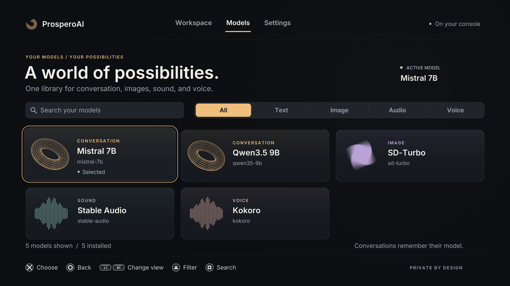

<p align="center">
  <a href="sce_sys/icon0.png"></a>
</p>

<h1 align="center">ProsperoAI</h1>

<p align="center">
  <strong>Local generative AI for PlayStation 5 homebrew</strong><br>
  Chat with LLMs, generate 512 × 512 images and short audio, and synthesize speech,
  all locally on the PS5 GPU.
</p>

<p align="center">
  
  
  
  
  <a href="LICENSE"></a>
</p>



The interface is built with [ps5-homebrew-ui](https://github.com/blackbearreloaded/ps5-homebrew-ui),
fetched at a pinned commit when the app is built. This picture is the production frontend
drawn on a PC with stand-in models. See the [UI guide](docs/NATIVE_UI.md) for the pages,
how it is built, and what a run on a console showed.

> [!WARNING]
> ProsperoAI is an experimental project for validating generative-AI workloads
> on the PS5 GPU. It is not production software.

> [!NOTE]
> `vulkan-runtime` uses one upstream GGML v0.26.0/Vulkan runtime for llama.cpp text,
> Stable Diffusion, audio.cpp and Kokoro adapters on RADV. The dedicated AGC inference
> backend is removed. CPU operations still handle remaining media kernels; RADV
> continues to use the platform GPU driver. See [current status](docs/VK_ACTIVE.md),
> [media comparison](docs/MEDIA_VULKAN_COMPARISON.md) and [build instructions](docs/BUILDING.md).
> Bonsai's Prism PTQ1_0/PQ2_0 types are applied to the pinned upstream runtime by
> preparation scripts, so all curated models below share one GGML/Vulkan build.


## Highlights

- Runs supported models locally without an account, cloud API, or conversation upload.
- Uses `vulkan-runtime` for text and media compute, including exact Ternary Bonsai 2 27B.
- Searches and filters installed text, image, audio, and speech models in a scrolling library.
- Uses stable model IDs for selection and saved conversations, with no eight-model catalog limit.
- Offers Midnight and Daylight themes, a living backdrop, interface sounds, notices, reduced motion,
  high contrast, and larger text.
- Draws answers in Latin, Greek, Cyrillic, Chinese, Japanese and Korean with scalable faces.
- Stores independent text, image, audio, and speech sessions under `/data/prosperoai/sessions`.
- Supports DualSense navigation, right-stick conversation scrolling, the PS5 on-screen keyboard, and a physical USB keyboard.
- Offers 19 Chatterbox speech languages, selectable alongside the voice in Workspace and web settings.
- Ships without weights. Models offers verified presets and standalone GGUF downloads. See
  [Supported models](docs/SUPPORTED_MODELS.md) for curated text models that run through the
  shared GGUF runtime without model-specific adapters.
- Includes an HTTP server with a browser Workspace, model downloads and progress at
  `http://<PS5-IP>:11434/`.
- Connects OpenCode and other OpenAI-compatible clients to local PS5 text inference,
  with streaming responses and function-call support.

> [!IMPORTANT]
> ProsperoAI does not run on an unmodified retail console. It is intended for
> consoles you own with an already configured, compatible homebrew loader.
> This repository does not include an exploit, proprietary Sony SDK, firmware,
> system module, key, or model weight.

## Project foundation

> [!IMPORTANT]
> **Built on the [PS5 Native App Boilerplate](https://github.com/blackbearreloaded/ps5-native-app-boilerplate).**
> ProsperoAI preserves its reproducible native build, packaging, deployment,
> and release foundation.

## Supported curated models

Every currently runnable model installed in `/data/prosperoai/models/` has a curated
preset, including Mistral. The two Mistral storage entries (the flat GGUF and its old
`.ps5lm` folder) are one model and use the same preset. The old
`stable-audio-open-small` folder is a retained legacy asset from an earlier runtime; it
has no adapter in the current Vulkan build and is not offered as a runnable preset.

Every curated model was run three times on a base PS5, in rounds that visit all twelve
models in turn, so every request is also a model switch — the same path the native and web
interface use. Times are the HTTP request including model loading after the switch. Text
models answered an arithmetic check correctly and then generated 128 tokens; image outputs
were checked as 512 × 512 PNG, and audio and speech outputs for WAV structure, sample rate,
channels, nonzero samples and clipping. All 36 requests passed and the app stayed running.

| Curated preset | Purpose | PS5 runs 1 / 2 / 3 | Result |
| --- | --- | ---: | --- |
| [Mistral 7B Instruct v0.3 Q4_0](https://huggingface.co/QuantFactory/Mistral-7B-Instruct-v0.3-GGUF) | Text | 4.3 / 4.2 / 4.4 s | 3/3 correct, 72.5 tok/s |
| [Qwen3.8 9B Distill Q4_K_M](https://huggingface.co/empero-ai/Qwen3.8-9B-Distill-GGUF) | Text | 7.2 / 7.3 / 7.2 s | 3/3 correct, 53.1 tok/s |
| [MiniCPM5 2B Q8_0](https://huggingface.co/openbmb/MiniCPM5-2B-GGUF) | Text | 3.3 / 3.3 / 3.3 s | 3/3 correct, 109.1 tok/s |
| [Ternary Bonsai 2 27B PTQ1_0](https://huggingface.co/prism-ml/Ternary-Bonsai-2-27B-gguf) | Text | 13.9 / 14.0 / 14.1 s | 3/3 correct, 13.2 tok/s |
| [Granite 4.0 H-Tiny Q4_K_M](https://huggingface.co/ibm-granite/granite-4.0-h-tiny-GGUF) | Text | 5.2 / 5.2 / 5.4 s | 3/3 correct, 105.0 tok/s |
| [BoHF 12B MoE 3A Q3_K_M](https://huggingface.co/theprint/Bohf-12B-MoE-3A-GGUF) | Text | 6.7 / 6.9 / 6.8 s | 3/3 correct, 68.9 tok/s |
| [SD-Turbo FP16](https://huggingface.co/blackbearreloaded/ProsperoAI-SD-Turbo-FP16-PS5) | Image | 30.8 / 30.6 / 30.6 s | 3/3 valid 512 × 512 PNG |
| [Realistic Vision v5.1 FP16](https://huggingface.co/SG161222/Realistic_Vision_V5.1_noVAE) | Image | 35.9 / 36.1 / 36.0 s | 3/3 valid 512 × 512 PNG |
| [Stable Audio 3 Small SFX Q8_0](https://huggingface.co/audio-cpp/audio.cpp-gguf/tree/main/Stable-Audio-3-Small-SFX-GGUF) | Audio | 19.2 / 19.2 / 19.3 s | 3/3 valid 4 s stereo WAV, 44.1 kHz |
| [ACE-Step 1.5 Turbo Q8_0](https://huggingface.co/audio-cpp/audio.cpp-gguf/tree/main/ACE-Step1.5-GGUF/turbo) | Music | 114.4 / 114.3 / 114.3 s | 3/3 valid 8 s stereo WAV, 48 kHz |
| [Kokoro 82M Vulkan](https://huggingface.co/blackbearreloaded/ProsperoAI-Kokoro-82M-FP16-PS5) | Speech | 4.0 / 0.4 / 0.4 s | 3/3 valid 3.9 s mono WAV, 24 kHz |
| [Chatterbox 500M Q8_0](https://huggingface.co/audio-cpp/audio.cpp-gguf) | Speech, voice cloning | 14.3 / 14.4 / 14.4 s | 3/3 valid 4.2–4.5 s mono WAV, 24 kHz |

Full JSON record: [all models, three rounds](docs/performance/2026-10-14/pr27-all-models-3x-final.json).
Chatterbox speech was also checked by listening on the console.

The linked repositories contain the exact file layout, integrity hashes, upstream provenance,
licenses, and preparation recipe for each preset. The app releases its selected runtime after
the configured idle timeout and prepares it again on demand. See [Vulkan tuning profiles](docs/PS5_VULKAN_PROFILES.md)
to switch between `ps5` and the experimental `ps5pro` profile using
`/data/prosperoai/vulkan_tuning_profile.txt`.

### Legacy AGC text model preparation

The current release reads GGUF directly. These historical conversion tools are for
older releases and are not needed by `vulkan-runtime`. Install the equivalent GGUF
from Models before migrating a `.ps5lm` bundle. Known installed legacy Mistral/Qwen
IDs remain aliases to their GGUF models; the old bundle files are left untouched.

The open-source [model preparation tools](model-tools/) convert a supported
single-file GGUF into ProsperoAI's deterministic `model.ps5lm`,
`tokenizer.ps5tok`, and `model.json` bundle. Complete recipes for the validated
Mistral and Qwen models are included in the repository.

```bash
cd model-tools
./prepare-model \
  --provenance recipes/mistral-7b-instruct-v0.3-q4-0.json \
  /path/to/Mistral-7B-Instruct-v0.3.Q4_0.gguf \
  --output-dir /path/to/PPSA99004
```

The recipe verifies the exact upstream revision, byte count, SHA-256, tensor
layout, tokenizer, and every generated output. See the model-tools guide for
source-download commands, the Qwen example, recipe creation, supported GGUF
types, and the steps required when adding a new architecture.

A recipe prepares weights for a backend already implemented by ProsperoAI. It
cannot add an inference backend, tokenizer algorithm, or quantization format
that the application does not support.

### Performance notes

These are measured results from one PS5 on firmware 6.02, not guaranteed
benchmarks. Text decode figures describe a loaded model with a short or reused
context. The first prompt also pays model-loading and prefill cost. Attention
work grows with conversation length, so long sessions respond more slowly.
The 4,096-token text context boundary has been hardware-validated, but keeping
active conversations below roughly 2,000 tokens is currently more comfortable.

Image, general-audio, and speech generation prioritize correctness over speed.
Stable Audio currently emits only its short deterministic validation clip, and
Kokoro still uses a correctness-first CPU fallback for part of waveform
generation. Both are functional demonstrations rather than real-time paths.

## Install ProsperoAI and curated models

Your PS5 needs a compatible homebrew environment with ShadowMountPlus and a local ELF
loader listening on TCP port 9021. ProsperoAI uses the loader at first launch to request
storage access. It first checks for a running
[PS5-Lapy-JB-Daemon](https://github.com/mpereiraesaa/PS5-Lapy-JB-Daemon) service; otherwise,
it starts the one-request helper included in the app folder. You do not need to upload a
separate Lapy payload.

### Install from ProsperoStore

If you have [ProsperoStore](https://github.com/blackbearreloaded/ProsperoStore) installed,
search for **ProsperoAI** and choose **Install**. ProsperoStore downloads and installs the
app folder and sets the permissions needed to launch it. The app itself does not include
model weights; after launch, open **Models** and download the presets you want.

### Install from a release ZIP

1. Download `PPSA99004.zip` from the latest
   [GitHub release](https://github.com/blackbearreloaded/ProsperoAI/releases) and extract it.
   The archive contains a complete `PPSA99004/` app folder and an intentionally empty
   `PPSA99004/models/` directory.
2. Upload the complete `PPSA99004/` folder to a directory ShadowMountPlus scans, such as
   `/data/homebrew/`. The executable must end up at
   `/data/homebrew/PPSA99004/eboot.bin` (not one folder deeper).
3. If your FTP client does not preserve permissions, set the `PPSA99004/` folder and all
   files and subfolders inside it to `0777` recursively. In WinSCP, use **File permissions**
   and apply the change to files and subdirectories. In particular, `eboot.bin` and PRX
   modules must be executable; missing permissions can prevent the title from launching.
4. Wait for ShadowMountPlus to register the folder, or refresh/rescan its app list, then
   launch **ProsperoAI** from the home screen.
5. Open **Models** and download a Text, Image, Audio or Voice preset. Alternatively, copy
   standalone text GGUF files or complete curated model folders to
   `/data/prosperoai/models/`.

ProsperoStore handles the required permissions for its own installs and updates. For
manual installs, the exact permission behavior depends on the FTP client; see the
[ProsperoStore install notes](https://github.com/blackbearreloaded/ProsperoStore#install)
if the console reports that it cannot start the app.

The browser interface is at `http://<PS5-IP>:11434/`. Both interfaces show verified
preset downloads and progress. Text and media inference use `vulkan-runtime`; text models use GGUF.
Prepared legacy `.ps5lm` bundles require their equivalent GGUF for migration.

Everything the app keeps is under `/data/prosperoai/`:

```text
/data/
├── homebrew/PPSA99004/        the app folder
└── prosperoai/
    ├── models/
    │   ├── Mistral-7B-Instruct-v0.3.Q4_0.gguf
    │   ├── kokoro-82m-vulkan/
    │   └── sd-turbo-fp16/
    ├── sessions/              conversations, generated images and audio
    ├── logs/                  the debug log, when it is switched on
    └── prosperoai.cfg         settings
```

Keep each downloaded model folder intact. ProsperoAI discovers all valid model
folders at launch and shows their friendly names and purposes in Models. If
no compatible model is installed, the app opens normally and explains where to
add one.

Coming from 01.001.000: models in `/data/homebrew/prosperoai/models/` are moved to
`/data/prosperoai/models/` the first time this version starts, and settings and
conversations are copied over once. The storage helper of that version is no longer
used; if it is still running it is told to stop.

Without storage access (no ELF loader and no Lapy service) the app still opens and
keeps its data in its own sandboxed folder; models copied to `/data/prosperoai/models/`
are not visible to it then.

Only the app-folder ZIP is distributed; it contains no model weights.

### Reporting a problem

**Settings > Diagnostics > Debug log** makes the app write a timed trace of what it does:
the models it found, each request with its result and figures, every message it showed,
downloads with their speed, and what the model runtimes themselves report. It is off by
default. Switch it on, repeat what went wrong, close the app and send us
`/data/prosperoai/logs/debug-trace.txt` (the run before it is kept beside it as
`debug-trace.prev.txt`) in a
[GitHub issue](https://github.com/blackbearreloaded/ProsperoAI/issues). The log holds
your prompts and the answers of that run; read it before you share it.

## Updates

Once per launch ProsperoAI asks the [homebrew.page](https://homebrew.page) catalog whether a
newer version is listed, and verifies the catalog's signature before it believes the answer.
When there is one, it says so:

- **Update now** downloads the release from GitHub, checks it against the SHA-256 the
  catalog lists and closes the app. A small helper then puts the new version in place, and
  the console says when it is done: open ProsperoAI again.
- **What's new** shows the release notes first.
- **Skip** leaves everything as it is; the question comes back at the next launch.

Nothing is changed before the download has been checked, and a cancelled or failed update
leaves the app as it was. Models, settings and conversations are not touched: they live in
`/data/prosperoai`. Like storage access, the update needs the console's local ELF loader
(TCP port 9021).

This check and the downloads you start are the only requests the app makes on its own: one
to homebrew.page (and to the catalog's mirror on GitHub Pages when that does not answer),
naming the app and its version. Web search, described next, only sends a request when you
ask it to.

## Web search across sites

With **Web search** switched on in Settings, `/search <query>` in a conversation asks many
sites at once from the console itself and hands the answers to the model as sources to cite.
Nine groups of providers are available: the general web, code hosting, question sites,
reference works, package registries, papers, video, music and images, each with its own
checkbox in Settings so a search can be narrowed. A result carries the
address it came from and which provider found it, and a page several providers agree on is
ranked first.

`/fetch <url>` reads one page as plain text, so the model can follow a result it was given.
There is no JavaScript, so this works on static pages.

Over HTTP, `POST /api/search` takes a `query`, an optional `limit`, an optional `scopes`
array naming the groups to ask, and `fresh` to bypass the cache; `POST /api/fetch` takes a
`url`. Results of a search are kept in `/download0/prosperoai-search-cache.txt` for a day,
so repeating a query costs nothing and the sites are not asked again. Every request is
bounded in time and size, result text reaches the model as untrusted data, and a search
borrows about 64 KB per provider and releases it when the request ends, so it does not
compete with a loaded model for memory.

## HTTP server and browser interface

The HTTP server starts automatically when ProsperoAI launches. Keep the app running
on the PS5 and connect your computer or phone to the same network. Replace
`<PS5-IP>` below with your console's local IP address.

1. Open `http://<PS5-IP>:11434/` in your browser.
2. Use **Models** to download a preset or select an installed model. Download progress
   is shown while the files are fetched and verified.
3. Open **Workspace** and choose **Converse**, **Imagine**, **Compose** or **Speak**.
   A card selects an installed model for that purpose, or opens its Models category.
4. Use **Back to Workspace** to return; conversations can be deleted from their list.

Closing the PS5 app also stops its HTTP server. The API uses plain HTTP and requires
no key by default; use it on a trusted local network. Optional bearer authentication
and its effect on the browser interface are explained in [the API guide](docs/OPENCODE.md).

### Connect OpenCode to the PS5

ProsperoAI exposes an OpenAI-compatible API at `http://<PS5-IP>:11434/v1`, including
streaming text and function calls. OpenCode runs on your computer and uses the PS5
for model inference. First install a text model and check its exact ID:

```bash
curl 'http://<PS5-IP>:11434/v1/models'
```

Add this provider to your project's `opencode.json`. Replace `<PS5-IP>` and, if
needed, the model ID with the value returned above:

```json
{
  "$schema": "https://opencode.ai/config.json",
  "provider": {
    "prosperoai": {
      "npm": "@ai-sdk/openai-compatible",
      "name": "PS5 ProsperoAI",
      "options": { "baseURL": "http://<PS5-IP>:11434/v1" },
      "models": {
        "Mistral-7B-Instruct-v0.3.Q4_0.gguf": {
          "name": "Mistral PS5",
          "limit": { "context": 4096, "output": 512 },
          "tool_call": true
        }
      }
    }
  },
  "model": "prosperoai/Mistral-7B-Instruct-v0.3.Q4_0.gguf"
}
```

Run `opencode` in that project, or select the model with `/models`. This follows
OpenCode's [custom provider configuration](https://opencode.ai/docs/providers/#custom-provider).
Streaming and a tool-call roundtrip have been verified on PS5. Automatic tool
selection depends on the model; the tested Mistral model is not yet reliable for
autonomous coding tasks. See [OpenCode setup and API limits](docs/OPENCODE.md) for
larger contexts, authentication and detailed compatibility notes.

## Using ProsperoAI

| Input | Action |
| --- | --- |
| D-pad / left stick | Move through models, conversations, or settings; Left reaches the conversation list |
| Cross | Start or open a conversation, write or send a prompt, choose a model, change a setting |
| Circle | Close a dialog, leave the conversation list, or return to the settings categories |
| L1 / R1 | Switch between Workspace, Models, and Settings |
| Square | Start a new conversation in Workspace; search in Models |
| L2 / R2 in Models | Previous / next model category |
| Triangle | Insert Space while typing; otherwise retry, delete a focused conversation, or play saved audio; in Models, cancel the running download |
| While typing | Square deletes (hold to repeat), Triangle is Space, L1 is Shift, L2 switches between letters and symbols, R2 is Done (Send in a conversation); a held direction keeps moving |
| Options | Ask to close the app, once nothing is running and the conversation is saved |
| Right stick | Scroll through the current conversation |
| Physical USB keyboard | Type in the prompt field or the model search; Enter sends; Tab is R1 and Shift+Tab is L1 |

The row at the bottom right of every page names what the buttons do there.

Each conversation is an independent session. Text and metadata are saved under
`/data/prosperoai/sessions/`; generated image and audio files live inside
the matching session directory. Deleting a session removes its associated
content. ProsperoAI does not send these files to a network service.

## Roadmap

Ideas we would like to work on. They are not promises and carry no dates or order;
[open an issue](https://github.com/blackbearreloaded/ProsperoAI/issues) to argue for one or
to suggest another.

**Models and generation**

- Faster sound generation: a Stable Audio clip takes several minutes in the combined build.
- Vision models: let a text model look at a picture.
- Image-to-image, and variations of a generated picture.
- More image models beside SD-Turbo, with size and step settings.
- Speech to text: dictate a prompt through the DualSense microphone.
- Spoken answers: read a text answer aloud, with a choice of voices.
- Personas and system prompts, saved per conversation.
- Generation settings remembered per model.

**Model library**

- Resume an interrupted download instead of starting again, and clean up what a closed app
  left behind.
- Delete a model from the app, with the space it frees.
- A download queue.
- A Hugging Face token for repositories that need an account.
- GGUF files above 7 GiB, and split files.
- Before downloading a model, a hint of the memory it needs and the speed to expect.

**Conversations**

- Longer conversations and answers: 64 messages of 4 KB each are kept today.
- Export a conversation or a picture to USB, or fetch it from the browser page.
- Search, rename and pin conversations.
- Documents as context: ask about a text or PDF file from USB.

**Console experience**

- Menus in the console's language.
- A phone as keyboard and remote.
- Work in the background, with a notice when a picture or a download is done.
- Remember the last model whatever the length of its name.

**Server and integrations**

- Pictures, speech and sound over the OpenAI-compatible API, beside chat.
- An embeddings endpoint.
- A server page in Settings: address, key, connected clients, and a switch to turn it off.

**Under the hood**

- A faster update download.
- A cleaner debug log.
- An in-app benchmark: tokens per second and time per picture for each model.

## Build

Build from Linux, WSL, or an Ubuntu-compatible CI runner:

```bash
sudo apt update
sudo apt install ccache clang-18 clang-format-18 clang-tidy-18 lld-18 make \
  ninja-build pkg-config python3 python3-venv tar unzip wget

make lint test
# Set up Vulkan dependencies as documented in docs/BUILDING.md.
make app-release
```

Outputs:

```text
dist/PPSA99004/           complete model-free app folder
dist/PPSA99004.zip        archived model-free app folder
```

The build downloads and verifies the public PS5 Payload SDK, the ps5-opengl SDK, the
ps5-homebrew-ui interface kit, the Noto Sans faces for Chinese, Japanese and Korean, and zlib
inside the ignored `.deps/` directory. It bakes the interface fonts, rebuilds the clean-room
`libc.prx` runtime, compiles the native app through parallel incremental Ninja builds,
caches compiler results with ccache, signs the executable, validates assets,
and assembles the release. Set `USE_CCACHE=0` to disable the cache or
`BUILD_JOBS=<count>` to limit parallel compilation. Model weights are never
downloaded by the app build.

## GitHub Actions

The [Build workflow](.github/workflows/build.yml) runs on pull requests,
version tags (`NN.NNN.NNN`), and manual dispatch. A push to `main` builds
nothing; a build on `main` is started by hand (**Run workflow**). It:

1. restores dependency and ccache data;
2. validates source, metadata, presentation assets, and the executable writer;
3. reproduces and verifies the clean-room runtime shim;
4. builds pinned RADV and llama.cpp inputs, then the vulkan-runtime model-free folder and
   `PPSA99004.zip` with Ninja;
5. rejects an artifact containing model data;
6. writes `SHA256SUMS` and uploads both release files; and
7. publishes those verified files when triggered by a version tag.

A release is made by pushing the version tag: the workflow builds, attests and publishes
`PPSA99004.zip` and `SHA256SUMS`; release files are not attached by hand. If no release exists
for the tag, the workflow creates it with the notes from `CHANGELOG.md`. If one exists without
a ZIP (notes written in advance, or a draft), it adds the two files and leaves the title and
notes alone. If one already has a ZIP, nothing is replaced and the run ends with a warning.

A release ZIP built by the workflow can be checked with
`gh attestation verify PPSA99004.zip -R blackbearreloaded/ProsperoAI` (GitHub CLI); this covers
releases built by GitHub Actions from now on, not earlier ones.

Every pull request gets an installable build named by its number and commit:
see [Pull-request builds](docs/PULL_REQUEST_BUILDS.md).

## Project layout

```text
src/                 ProsperoAI UI, sessions, app lifecycle, and platform integration
include/             Stable application-facing interfaces and model catalog types
inference/           Unified model router, typed adapter contract, and inference backends
  router.cpp         Model discovery, one-model lifecycle, and API compatibility facade
  adapters/          llama.cpp/Vulkan text, SD, Stable Audio, and Kokoro PS5 adapters
  backends/vulkan/   Shared ggml/Vulkan media bridge
vulkan/              HTTP/OpenAI API, storage, RADV/PS5 platform services, and Vulkan UI
tools/vulkan-runtime/ CMake composition and host ABI tests for the shared ggml/Vulkan stack
runtime/             Bundled PS5 libc runtime and integrity record (not inference code)
assets/              The last-resort bitmap font (other fonts and sounds come from the kit)
ui-kit/              Which sources of the fetched interface kit are compiled
host/                Deterministic native-frontend capture harness
tests/console/       Scripts the app plays by itself in a test run on a console
sce_sys/             PS5 title metadata, artwork, icon, and selection music
models/README.txt    Model-free release placeholder and install guidance
model-tools/         GGUF converter, validated recipes, and porting guide
vendor/              Pinned headers and static runtime dependencies
tooling/native/      Native ELF/FSELF and runtime build tools
tools/               Build, dependency, validation, packaging, and deploy scripts
```

Stable Audio's OpenCL retirement, SA3 PS5 TLS teardown fix, and console evidence are tracked in
[`docs/OPENCL_TO_VULKAN_RESEARCH.md`](docs/OPENCL_TO_VULKAN_RESEARCH.md).

Generated files are saved by modality under `work/image/`, `work/audio/`, and `work/voice/`
in ProsperoAI's persistent data folder; text responses are saved under `work/text/`. Each
generated asset gets its own filename and is referenced from its conversation; media stays in
PNG/WAV form and text exports are plain `.txt` files.

For responsibilities and the adapter contract, see [Inference layers and adapters](docs/INFERENCE_ADAPTERS.md).

## Identity

| Identity | Value |
| --- | --- |
| Shell title | `ProsperoAI` |
| Title ID | `PPSA99004` |
| Current app version | `01.005.000` |
| Writable data | `/data/prosperoai` (the app's sandbox without storage access) |
| Compute backend | `vulkan-runtime` on RADV, with documented CPU media operations |

<!-- bbr-footer:start -->
<!-- Generated by ps5-homebrew-dev-protocol/scripts/readme-footer. Edit the template there, not here. -->

## Credits

Built with the [PS5 Payload SDK](https://github.com/ps5-payload-dev/sdk) by John Törnblom (ps5-payload-dev).
Third-party components, authors and licenses are listed in
[THIRD_PARTY_NOTICES.md](THIRD_PARTY_NOTICES.md).

## License

Copyright © 2026 BlackBearReloaded. Licensed under GPL-3.0-or-later; see [LICENSE](LICENSE). Third-party components keep their own licenses.

## Disclaimer

- **No affiliation.** This is an independent homebrew project. It is not
  affiliated with, endorsed by, or sponsored by Sony Interactive Entertainment.
  "PlayStation", "PS5" and related marks are trademarks of Sony Interactive
  Entertainment Inc. Model names belong to their authors, who do not endorse this project.
- **No proprietary material.** No Sony SDK, firmware, encryption keys or
  decrypted system modules are included.
- **No warranty.** This project is provided "as is", without warranty of any
  kind, to the extent permitted by law. See sections 15 and 16 of the GPL.
- **Use at your own risk.** Running homebrew requires a modified console, which
  may void its warranty, breach the platform's terms of service, or cause data
  loss.
- **Legal use only.** Use it only with hardware, accounts and content you own.
  This project does not support or enable piracy.

## AI assistance

This project was developed with AI assistance from OpenAI and/or Anthropic tools.
<!-- bbr-footer:end -->
